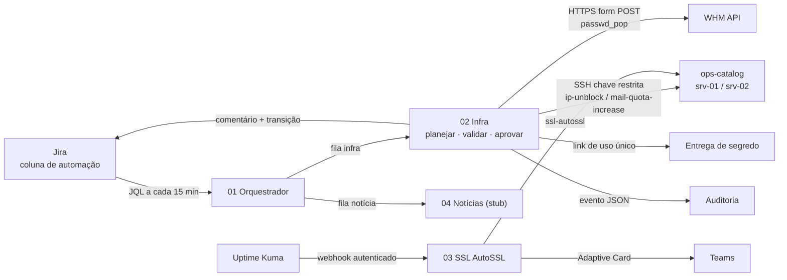

# jira-n8n-ops-automation

Automação de operações de hospedagem a partir de cards do Jira, orquestrada no n8n: desbloqueio de IP no firewall, aumento de cota e redefinição de senha de e-mail, e renovação de SSL via AutoSSL, com **nenhum texto de card virando comando**.

n8n · Jira Cloud REST v3 · cPanel/WHM · CSF · Uptime Kuma · Microsoft Teams · Node.js (`node:test`)

Este repositório é uma versão de referência, genérica e didática, de automações que desenhei para uma equipe de operação de sites. Não é cópia de ambiente real: servidores, domínios, contas e endereços são fictícios (`srv-01`, `example.com`, `example.atlassian.net`, faixas de IP de documentação), e as decisões de segurança estão descritas como requisitos de projeto.

## O que é

- **Orquestrador** (`01`): a cada 15 minutos em horário comercial, busca no Jira os cards da coluna *Selecionado para Automação* ainda não reivindicados e separa em filas **Infra** e **Notícia**.
- **Infra** (`02`): classifica cada card, valida os campos, confere aprovação e allowlist, reivindica o card, executa uma operação de **catálogo fixo** no servidor certo, comenta, move o card e registra auditoria.
- **SSL AutoSSL** (`03`): o Uptime Kuma avisa 5 dias antes do vencimento; o n8n resolve domínio → conta → servidor pelo inventário, dispara o AutoSSL, classifica (`success`, `dns_manual`, `other_failure` com 1 retry) e avisa no Teams.
- **Notícias** (`04`): stub que entrega um payload mínimo e idempotente a um serviço externo de publicação.



Detalhes em [docs/arquitetura.md](docs/arquitetura.md) e [docs/workflows.md](docs/workflows.md).

## Estrutura

```
.
├── workflows/                    # JSON importáveis no n8n (gerados a partir de src/)
│   ├── 01-orquestrador.json
│   ├── 02-infra-ops.json
│   ├── 03-ssl-autossl.json
│   └── 04-noticias-stub.json
├── src/                          # lógica dos nós Code, em módulos testáveis
│   ├── validators.js             # IPv4/IPv6 público, e-mail, usuário cPanel, hostname, chave de card
│   ├── text.js · classify.js     # ADF -> texto, campos "Chave: valor", atividade e fila
│   ├── inventory.js · approval.js# inventário (fonte da verdade) e aprovação via changelog
│   ├── catalog.js                # catálogo fixo + quoting seguro
│   ├── plan.js                   # decisão por card: execute / dry_run / reject / defer / skip
│   ├── password.js               # senha com crypto.randomInt
│   ├── result.js · jira.js       # interpretação do retorno, comentário ADF, transição
│   ├── ssl.js · news.js          # AutoSSL + Teams, filas e payload de notícias
│   └── audit.js                  # evento de auditoria sem campos sensíveis
├── server/                       # lado servidor: wrapper, sudoers, authorized_keys, conf
├── scripts/
│   ├── build-workflows.js        # embute src/ nos nós Code e gera workflows/
│   └── validate-workflows.js     # parse, conexões, credenciais por nome, varredura de segredos
├── test/                         # node:test, incluindo execução dos nós Code em sandbox
├── config/inventory.example.json
├── docs/                         # arquitetura, workflows, ameaças, runbook, importação
└── .env.example
```

## Quick start

Pré-requisitos: Node.js 20+ (só para testes e build; o n8n não precisa de dependências extras) e uma instância n8n 1.x.

```bash
git clone https://github.com/<usuario>/jira-n8n-ops-automation.git
cd jira-n8n-ops-automation

npm test          # 48 testes: validadores, planejador, catálogo, senha, SSL, workflows
npm run check     # workflows/ em dia com src/ + validação estática dos JSON
```

No n8n:

1. Configure as variáveis de `.env.example` (dry-run ligado, allowlist mínima).
2. Crie as credenciais com os nomes usados nos workflows (`Jira API`, `SSH srv-01`, `WHM API srv-01`, ...).
3. Importe `02`, `04`, `03` e `01`, nesta ordem, e informe os IDs dos subworkflows.
4. Instale `server/ops-catalog.sh` e a chave restrita em cada servidor.

Passo a passo completo em [docs/importacao.md](docs/importacao.md).

## Atividades suportadas

| Atividade (`OPS_ALLOWED_ACTIVITIES`) | Disparo | Entrada validada | Execução |
|---|---|---|---|
| `ip_unblock` | título com "desbloqueio de IP" | IP **público** v4/v6 + cliente do inventário | `ip-unblock <ip>`: remove de deny/temp-deny no CSF; sem allow permanente |
| `mail_quota_increase` | "aumentar cota", "caixa cheia" | e-mail cujo domínio **pertence à conta** | `mail-quota-increase <usuario> <local> <dominio>`: +N% com teto |
| `mail_password_reset` | "redefinir senha" | idem + contato responsável cadastrado | WHM `passwd_pop` via HTTPS; senha entregue por link de uso único ao contato do inventário |
| `usage_report` | "relatório de usabilidade" | – | sempre manual (triagem) |

Template de descrição do card:

```
Cliente: clientea
IP: 203.0.113.25
E-mail: joao@cliente-a.example.com
```

## Decisões de segurança

**1. Segredos só no cofre de credenciais do n8n.** Os workflows referenciam credenciais apenas pelo nome; nenhum nó Code contém token, senha, client secret ou identificador de tenant. `$env` carrega só configuração (URLs, nomes de status, limites). `scripts/validate-workflows.js` falha se encontrar credencial com id/valor, token, GUID, IP fora das faixas de documentação ou e-mail fora de `example.com`.

**2. Texto do card nunca vira comando.**
- Validação estrita antes de montar qualquer coisa: IP com parser próprio (sem zeros à esquerda, sem sufixo, IPv6 canonizado) e **rejeição de faixas privadas/reservadas** (RFC 1918, loopback, link-local, CGNAT, multicast, documentação, ULA); e-mail em formato simplificado **com domínio pertencente à conta**; usuário cPanel `^[a-z][a-z0-9]{0,15}$` **existente no inventário**; chave do card validada antes de compor URL.
- **Catálogo fixo**: o n8n escolhe uma operação conhecida e passa argumentos de charset seguro; o nó SSH não aceita texto livre.
- **Do lado do servidor**, a chave da automação usa `restrict,from=...,command="sudo -n /usr/local/sbin/ops-catalog"` e o sudo só permite o wrapper sem argumentos. O wrapper revalida tudo com implementação independente (`ipaddress` do Python, regex bash, `/etc/userdomains`) e só conhece três operações. Quem pode criar card não pode virar root.
- Quoting POSIX (`shQuote`) para o modo alternativo `sudo-wrapper`.

**3. Senha forte e fora do Jira.** Senha de 20 caracteres com `crypto.randomInt` (~121 bits), sem prefixo, sufixo, ano ou nome do cliente. Vai para o WHM no corpo de um POST HTTPS (não em linha de comando nem query string) e para o titular por **link de uso único** de um serviço de entrega de segredo; o destinatário vem do inventário, não do card. O comentário no Jira diz apenas que a senha foi redefinida. O workflow de infra não salva dados de execução.

**4. Guardrails de execução.**
- **Dry-run por padrão** (`OPS_DRY_RUN=true`): decisões auditadas, nada executado.
- **Allowlist** de atividades; vazia = nada executa.
- **Aprovação**: só executa se a última transição para a coluna de automação foi feita por um aprovador, e ele não é o autor do card (quatro olhos).
- **Limite por ciclo** (`OPS_MAX_ACTIONS_PER_RUN`); excedentes ficam para o próximo ciclo.
- **Idempotência**: o card é reivindicado (label + responsável) **antes** da execução e a JQL exclui o label; duplicatas no mesmo ciclo são descartadas; o wrapper serializa com `flock`; alertas de SSL são deduplicados por domínio.
- **Trilha de auditoria**: um evento JSON por decisão (card, atividade, decisão, motivo, aprovador, servidor, comando, argumentos validados), com verificação que impede campos sensíveis; syslog no servidor.

**5. Outros cuidados.** Correspondência exata de cliente e domínio (nada de substring), ambiguidade = triagem manual; comentários com mensagens fixas por motivo (sem refletir texto do card nem stderr); webhook do Kuma com header de autenticação; `allowUnauthorizedCerts` desligado; retry do SSL limitado por `$runIndex`; payload do Teams montado como objeto.

Modelo de ameaças completo em [docs/modelo-de-ameacas.md](docs/modelo-de-ameacas.md).

## Testes e validação

- `npm test`: validadores (inclusive tentativas de injeção), planejador ponta a ponta, catálogo, gerador de senha (classes, unicidade, ausência de padrão por posição), interpretação de resultados, JQL, SSL e Teams.
- Os testes também **executam o código real de nós Code** extraído dos JSON num sandbox `vm`, com `$input`/`$env` simulados.
- `npm run check`: garante que `workflows/` foi gerado a partir do `src/` atual e valida estrutura, conexões e ausência de segredos.

## Operação

Pausar, voltar para dry-run, habilitar atividades, cards presos, falhas de Jira/SSH/WHM e respostas a alertas de SSL: [docs/runbook.md](docs/runbook.md).

## Limitações

- O inventário vem de uma variável de ambiente; para frotas grandes, use um serviço de inventário.
- Nomes de funções WHM/cPanel no wrapper devem ser conferidos na sua versão antes de produção.
- A senha existe em memória no n8n entre geração e entrega. A alternativa mais forte é gerar e entregar a partir do próprio servidor.
- Relatório de usabilidade, criação de caixas e backup ficaram fora do catálogo automatizado de propósito.

## Licença

[MIT](LICENSE) © 2026 Lygia Teixeira
