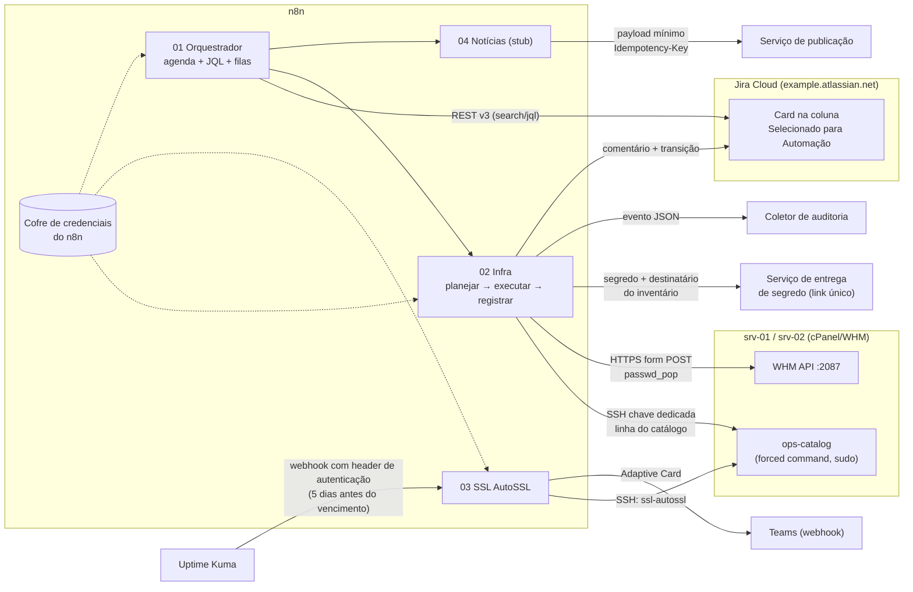
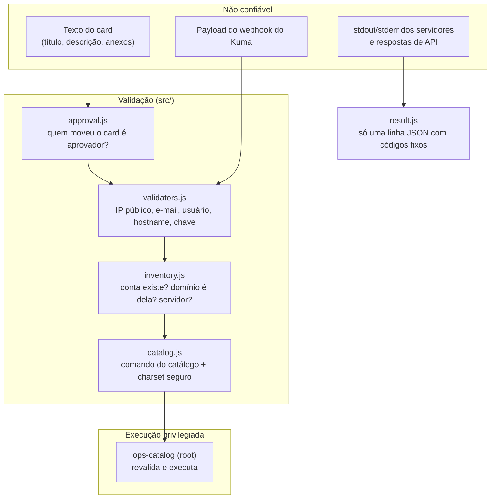

# Arquitetura

## Visão geral

## Componentes

| Componente | Papel | Onde está |
|---|---|---|
| Orquestrador | A cada 15 min (dias úteis, horário comercial) busca cards na coluna de automação, sem o label de reivindicação, e separa em filas `infra` e `noticia`. | `workflows/01-orquestrador.json` |
| Infra | Planeja (classifica, valida, verifica aprovação e allowlist, aplica limite por ciclo), reivindica o card, executa via catálogo, comenta, move e audita. | `workflows/02-infra-ops.json` |
| SSL AutoSSL | Recebe alerta do Uptime Kuma, resolve domínio → conta → servidor pelo inventário, dispara AutoSSL via catálogo, classifica e notifica no Teams. | `workflows/03-ssl-autossl.json` |
| Notícias | Stub: monta payload mínimo e entrega a um serviço externo idempotente. | `workflows/04-noticias-stub.json` |
| Lógica dos nós Code | Módulos JS puros, testados com `node:test` e embutidos nos nós pelo build. | `src/`, `scripts/build-workflows.js` |
| Wrapper de servidor | Único ponto de entrada da automação no servidor. Revalida tudo e só executa operações do catálogo. | `server/ops-catalog.sh` |
| Inventário | Fonte da verdade: contas, servidor, domínios, contato responsável. | `OPS_INVENTORY_JSON` (`config/inventory.example.json`) |

## Fronteiras de confiança

Princípios:

1. **Dado do card nunca é código.** Todo valor passa por validador estrito e vira argumento de uma entrada fixa do catálogo. Não existe nó que monte shell a partir de texto.
2. **O inventário decide, o card só pede.** Servidor, dono do domínio e destinatário de senha vêm do inventário, nunca do texto.
3. **Quem cria card não autoriza execução.** A automação confere no changelog quem moveu o card para a coluna de automação.
4. **Falhar fechado.** Sem aprovadores configurados, sem allowlist ou com qualquer ambiguidade, o card vai para triagem manual.
5. **Menor privilégio por canal.** SSH com chave dedicada, `restrict` + `command=` + `from=`, usuário sem shell útil; WHM com token dedicado por servidor; credenciais Jira só da conta de serviço.
6. **Nada sensível em histórico.** O workflow de infra não salva dados de execução, comentários não trazem segredos nem saída bruta, auditoria tem verificação de campos proibidos.

## Por que o código dos nós é gerado

Os nós Code do n8n não importam módulos locais. Em vez de duplicar a lógica no JSON, `scripts/build-workflows.js` concatena os módulos de `src/` necessários a cada nó e acrescenta uma cola curta. Assim:

- o que roda no n8n é exatamente o que foi testado;
- `npm run check` falha se alguém editar `src/` e esquecer de regenerar `workflows/`;
- os testes executam o código de nós reais num sandbox (`vm`) com `$input`/`$env` simulados.
