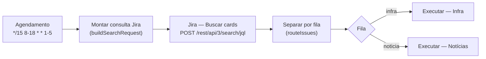
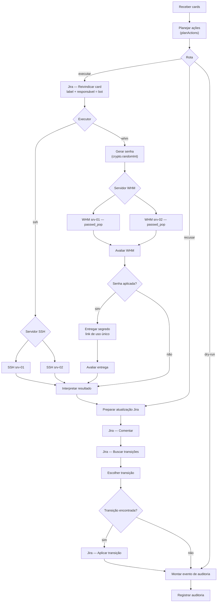
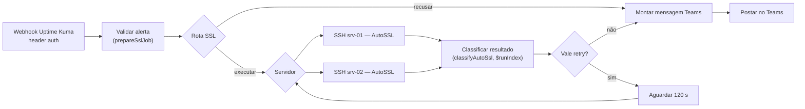
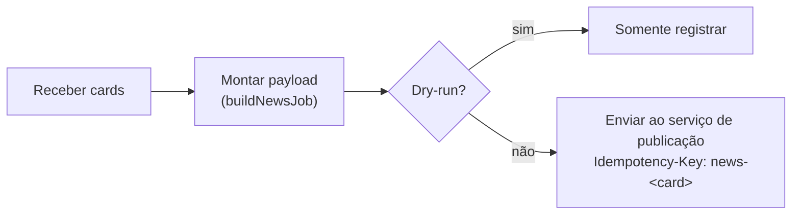

# Fluxo de cada workflow

## 01 Orquestrador



- JQL: `project IN (...) AND status = "<coluna de automação>" AND (labels IS EMPTY OR labels NOT IN ("<label de reivindicação>")) ORDER BY created ASC`, com `expand=changelog` para a verificação de aprovação.
- Fila decidida por label (`infra`, `noticia`, `publicacao`) ou prefixo do título (`[Infra]`, `[Notícia]`). Card que casa com as duas filas é ignorado.
- Subworkflows chamados uma vez por ciclo com todos os itens da fila (`mode: once`).

## 02 Infra



Decisões do planejador (`src/plan.js`), na ordem:

| Etapa | Falha leva a | Motivo registrado |
|---|---|---|
| Chave do card válida (`^[A-Z][A-Z0-9_]{1,9}-[1-9][0-9]*$`) | `skip` | `invalid_issue_key` |
| Sem label de reivindicação | `skip` | `already_claimed` |
| Última transição para a coluna feita por aprovador, e aprovador ≠ autor (quatro olhos) | `reject` | `not_approved` |
| Atividade identificada pelo título ou campo `Atividade` (uma só) | `reject` | `activity_unrecognized` |
| Atividade automatizável e presente na allowlist | `reject` | `manual_activity` / `activity_not_allowed` |
| Campos sem duplicidade conflitante | `reject` | `ambiguous_fields` |
| Cliente existe no inventário (match exato) | `reject` | `client_missing` / `client_not_found` / `client_ambiguous` |
| IP público válido / e-mail válido e de domínio da conta / contato cadastrado | `reject` | `ip_invalid` / `email_invalid` / `email_domain_not_owned` / `no_contact` |
| Limite de execuções por ciclo | `defer` | `run_limit_reached` |
| `OPS_DRY_RUN=true` | `dry_run` | – |

Template de card esperado (descrição, uma linha por campo):

```
Cliente: clientea
IP: 203.0.113.25
E-mail: joao@cliente-a.example.com
Atividade: ip_unblock        (opcional; senão vale o título)
```

Catálogo:

| Atividade | Executor | Comando enviado | O que o servidor faz |
|---|---|---|---|
| `ip_unblock` | SSH | `ip-unblock <ip>` | `csf -dr` + `csf -tr`; allow temporário opcional; confere que saiu do `csf.deny`. Sem allow/ignore permanente. |
| `mail_quota_increase` | SSH | `mail-quota-increase <usuario> <local> <dominio>` | Lê cota, aplica +N% com teto (`QUOTA_MAX_MB`), confere a resposta da UAPI. |
| `mail_password_reset` | WHM API | form POST `uapi_cpanel` `Email/passwd_pop` | Senha gerada no n8n por CSPRNG, enviada no corpo HTTPS (não em linha de comando) e entregue por link de uso único ao contato do inventário. |
| `usage_report` | manual | – | Sempre vai para triagem. |

## 03 SSL AutoSSL



- Só eventos cuja mensagem fala de certificado e expiração; o resto é ignorado.
- Domínio extraído de `monitor.hostname` ou `monitor.url`, validado e resolvido pelo inventário (sufixo em fronteira de rótulo; `loja.example.com` não casa com `minhaloja.example.com`).
- Deduplicação por domínio na janela `SSL_DEDUP_HOURS` (static data do workflow).
- `success`: nenhum problema para o domínio. `dns_manual`: problema de validação DNS (ex.: wildcard), sem retry. `other_failure`: até `SSL_MAX_RETRIES` novas tentativas; a contagem usa `$runIndex` do nó, então o loop sempre termina.
- Mensagem do Teams é um Adaptive Card montado como objeto e serializado com `JSON.stringify`.

## 04 Notícias (stub)



O payload leva chave do card, título sem prefixo, texto da descrição e metadados dos anexos (id, nome, tipo, tamanho), sem URLs de download nem credenciais. O serviço externo busca o que precisar com a própria credencial, reivindica e conclui o card.
